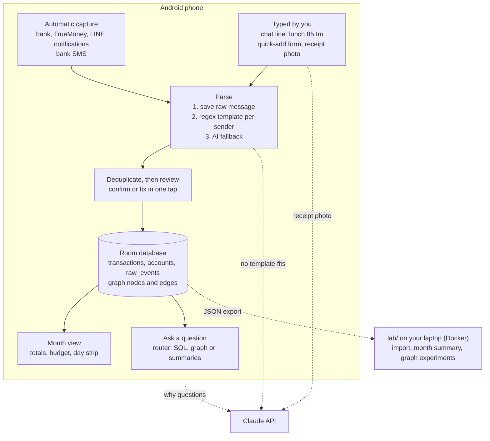

# Kahagayo

**कहाँ गयो? Where did my money go?**

Kahagayo is a personal finance app for Android that records every baht you spend, from your bank, TrueMoney and cash, mostly without typing. It answers questions about your money in plain language. *Hatti khoi?* (where's the elephant, the 1,000-rupee note) is its mascot's line.

> Status: **planning and scaffolding** (November 2026). Spending has been logged since 1 November 2026 in the web tracker; the Android app is next.

## How it fits together



Questions take the cheapest route that can answer them:

| Question | Route | Cost |
| --- | --- | --- |
| "How much on food this week?" | SQL over the database | no AI call |
| "What do I buy at 7-Eleven?" | local graph search | fast model |
| "Why did November cost more?" | monthly summaries | larger model |

More detail: [docs/architecture.md](docs/architecture.md).

## Repository layout

```
kagayo/                     (repository: kahagayo)
├── README.md               this file
├── CLAUDE.md               instructions Claude Code reads before working here
├── docker-compose.yml      lab API and test runners
├── .github/workflows/ci.yml  runs every test on each push
├── docs/
│   ├── architecture.md     diagrams, data model, decisions
│   ├── setup-windows.md    first-time Git, GitHub and Docker steps
│   └── android-setup.md    creating the Android project
├── shared/parser/          reference chat-line parser (JavaScript) + 30 test cases
├── lab/                    Python service for imports, summaries and graph experiments
│   ├── app/                ledger, graph builder, HTTP API (standard library only)
│   ├── tests/              unit and end-to-end tests
│   ├── sample-data/        EXAMPLE export (not real spending)
│   └── Dockerfile
├── android/                Kotlin app (created with Android Studio, see docs/android-setup.md)
└── private/                your real exports; ignored by Git
```

## Getting started

First time on this laptop? Follow [docs/setup-windows.md](docs/setup-windows.md).

Run the lab API in Docker:

```bash
docker compose up --build lab
# open http://localhost:8000/health
curl -X POST http://localhost:8000/import -H "Content-Type: application/json" --data-binary @lab/sample-data/example-export.json
curl http://localhost:8000/months/2026-11/summary
curl "http://localhost:8000/graph/related?node=merchant:7-eleven"
```

Run the tests:

```bash
docker compose --profile test run --rm test-parser
docker compose --profile test run --rm test-lab
```

Without Docker: `node shared/parser/test.js` and, inside `lab/`, `python -m unittest discover -s tests`.

## Lab API

| Method | Path | What it does |
| --- | --- | --- |
| GET | `/health` | OK and the number of stored transactions |
| POST | `/import` | Import a Kahagayo JSON export; re-importing the same file updates, never duplicates |
| GET | `/transactions?month=2026-11` | Stored transactions |
| GET | `/months/2026-11/summary` | Spent, received, moved, daily average, pace, by category and account, per day |
| GET | `/graph/stats?month=2026-11` | Node and edge counts by type |
| GET | `/graph/related?node=merchant:7-eleven` | What a merchant, category or account connects to |

Transfers between your own accounts (a TrueMoney top-up from the bank) are never counted as spending. Money is stored as whole satang.

## Roadmap

| When | Phase | Done when |
| --- | --- | --- |
| From 1 Nov 2026 | Log in the web tracker | — |
| 2–15 Nov | Android skeleton: database, month screen, quick add, parser port, JSON import, notification logger | the app replaces the tracker on the phone |
| 16–30 Nov | Automatic capture: bank and TrueMoney parsers, deduplication, review inbox, receipts | most spending arrives without typing |
| December | Budget from November's pattern, graph builder, question router v1 | a full month of data is in the app |
| January 2027 | Why questions, monthly summaries, routing cost experiment | answers match SQL on test questions |

## Privacy

Spending data stays on the phone and in `private/`, both outside Git. Only the text of a single receipt or alert is sent to the Claude API when rules can't parse it. API keys go in `.env` or the app's settings, never in code.

## Links

- Design plan (Claude doc): https://claude.ai/artifact/BSn6EmQMd1HqC6nKy5w5R3
- Web tracker (Claude artifact): https://claude.ai/artifact/2fy9pwvNdaVqBmaaUxa8Gj
