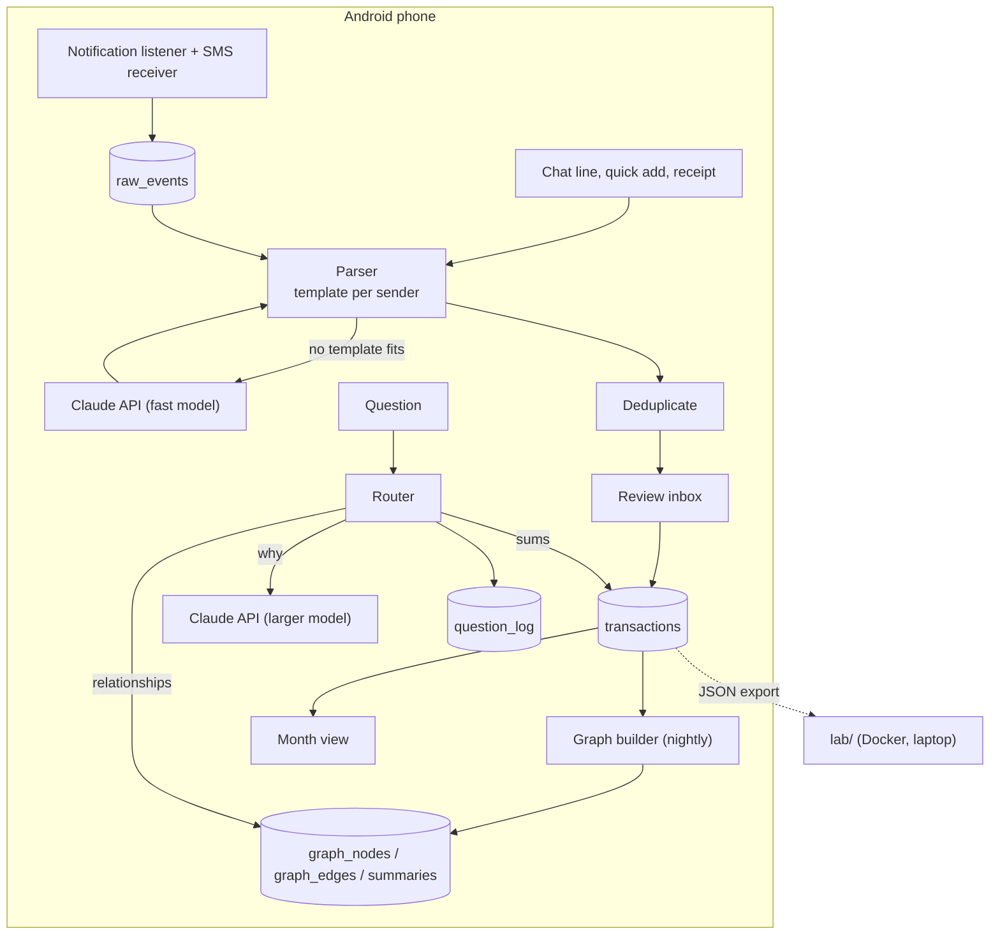

# Architecture

Kahagayo keeps everything in one database on the phone and calls an AI model only when rules can't do the job.

## System

## Capture pipeline

1. Every SMS or notification from a listed app is saved to `raw_events` first, untouched.
2. A regex template for that sender extracts amount, direction, account, merchant and time.
3. If no template matches, a fast model extracts the same fields as JSON.
4. Duplicates (same amount and account within 2 minutes, e.g. SMS + LINE + app push) are merged.
5. New transactions land in the review inbox; a fix becomes a new template example.

## Question routing

| Route | Data | Model | Example |
| --- | --- | --- | --- |
| SQL | transactions | none | How much on food this week? |
| Local graph | nodes and edges around a merchant, category, person or event | fast | What do I buy at 7-Eleven? |
| Global | monthly cluster summaries | larger | Why did November cost more? |

Each answer is logged with route, model, tokens, latency and correctness, so routing can be compared with always using the largest model.

## Graph

Built from structured fields without an LLM:

- Nodes: tx, merchant, category, account, day, week, month
- Edges: PAID_TO, IN_CATEGORY, FROM, TO, ON, IN_WEEK, IN_MONTH

Added later with an LLM, only for entries with free text: person (WITH), event (PART_OF), receipt item (CONTAINS).

`lab/app/graph.py` is the reference implementation of the structured part.

## Data model

| Table | Key fields |
| --- | --- |
| transactions | id, date, time, type, amount_satang, currency, category, account, to_account, note, merchant, source, raw_event_id, created_at, updated_at |
| accounts | id, name, code, kind, sms_senders, app_packages |
| raw_events | id, channel, sender, text, received_at, status, transaction_id |
| parser_templates | id, sender, pattern, field_map, example |
| graph_nodes | id, type, label, props |
| graph_edges | source_id, target_id, type, transaction_id, weight |
| summaries | scope, key, text, model, created_at |
| question_log | id, question, route, model, tokens, latency_ms, correct |

## Decisions

| Decision | Why |
| --- | --- |
| Read notifications and SMS on the phone | No open API gives a personal app Thai bank or TrueMoney history; BOT "Your Data" starts late 2026 for regulated providers |
| Install by USB, not Google Play | Play allows SMS permissions only for default SMS, phone or assistant apps |
| Integer satang | Float sums drift |
| Graph from fields first, LLM later | Most of the graph is free to build; saves tokens |
| Lab uses only the Python standard library | Runs anywhere, Docker image needs no downloads |
| Android project made by Android Studio | Its wizard writes a working Gradle wrapper and current versions |
